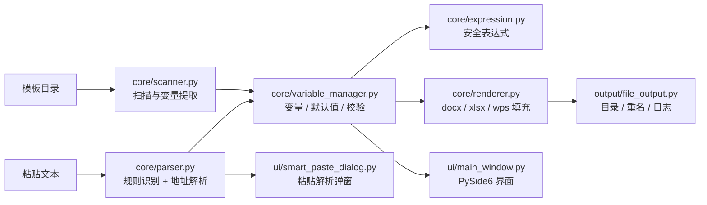

<div align="center">


<h1>DocFill</h1>

<p><b>文档智能解析与批量填充工具</b><br />
把一段客户资料，变成一整套填好的 Word / Excel 文档。</p>

<p>
  <a href="https://github.com/daokunn/docfill/actions/workflows/ci.yml">
    
  </a>
  
  
  
  
</p>

<p>
  <a href="#快速开始">快速开始</a> ·
  <a href="#界面预览">界面预览</a> ·
  <a href="#模板规范">模板规范</a> ·
  <a href="#项目架构">项目架构</a> ·
  <a href="docs/使用说明.md">详细使用说明</a>
</p>

</div>

---

## 这是什么

**DocFill** 是一个面向内网、离线环境的 Windows 桌面工具。它扫描 Word / Excel 模板中的 `{{变量}}`，把粘贴进来的原始业务文本解析成结构化字段，再批量生成整套文档。

- **完全离线**：不调用任何在线 API，不上传任何数据。
- **模板只读**：填充过程只读取模板，所有结果写入独立输出目录。
- **批量生成**：一次录入，生成同一业务下的全部 Word / Excel 模板。
- **面向真实业务**：支持多人数据、变量表达式、地址拆分、重名策略和操作日志。

> 适合银行、政务、保险、行政等需要“固定模板 + 大量重复填表”的场景。

## 为什么是 DocFill

| 传统做法 | DocFill |
| --- | --- |
| 在多个 Word / Excel 之间反复复制粘贴 | 一次录入，全部模板自动填充 |
| 手工拆分姓名、证件号、手机号、地址 | 粘贴原始文本，本地规则自动识别 |
| 文件命名混乱、重复生成互相覆盖 | 业务名_客户名_年月 + 三种重名策略 |
| 数据被上传到不明在线工具 | 全程本地运行，数据不出电脑 |
| 模板被误改，原文件丢失 | 生成到独立目录，模板保持只读 |

## 功能

- **模板扫描**：递归扫描业务目录，自动提取 `.docx` / `.xlsx` / `.wps` / `.et` 中的变量，多个模板的同名变量自动合并。
- **智能粘贴**：基于本地正则规则 + 键值对识别，支持姓名、身份证号、手机号、单位、地址、日期等字段。
- **地址拆分**：内置省市区字典，将完整地址拆成省 / 市 / 区 / 详细地址。
- **多人模式**：用独占一行的 `---` 或 `===` 分隔多人数据，逐人生成文档。
- **变量表达式**：`substr`、`concat`、`split`、`replace`、`today` 等函数，身份证取出生日期、地址取城市等场景无需手算。
- **输出治理**：按 `业务名_客户名_年月` 建目录，支持追加序号 / 覆盖 / 跳过，自动写操作日志。
- **本地配置**：识别规则、默认值、别名、地址字典均可外置修改，无需改代码。

## 界面预览

主界面已在上方展示。下面是智能粘贴解析的工作方式：粘贴原始文本，本地规则自动拆出姓名、证件号、手机号和地址。


## 快速开始

### 环境要求

- Windows 10 / 11（64 位）
- Python 3.11（推荐；3.9+ 理论可用，未逐一验证）
- 依赖：PySide6、python-docx、openpyxl

### 从源码运行

```powershell
git clone https://github.com/daokunn/docfill.git
cd docfill

python -m venv .venv
.\.venv\Scripts\Activate.ps1
python -m pip install -r requirements.txt

python main.py
```

如果 PowerShell 阻止激活虚拟环境，可只在当前窗口临时放开：

```powershell
Set-ExecutionPolicy -Scope Process -ExecutionPolicy Bypass
```

### 5 分钟跑通示例

仓库自带一套演示模板和虚构数据：

1. 启动后，**模板根目录**选择 `examples\templates`。
2. **输出根目录**选择 `examples\output`。
3. 左侧选择 **公务卡申请**。
4. 点击 **智能粘贴解析**，粘贴下面的示例文本，点击 **智能解析** → **确认填充**。
5. 点击 **一键生成文档**，在 `examples\output` 查看结果。

```text
姓名：张三
身份证号：360700199001011234
手机号：13812345678
单位：某某科技有限公司
地址：江西省赣州市章贡区红旗大道123号
申请日期：2026-10-18
```

> 示例中的姓名、证件号码、手机号均为虚构数据，仅用于演示。

### 打包为 exe

```powershell
python -m pip install -r requirements-dev.txt
python -m PyInstaller build.spec --noconfirm
```

产物位于 `dist\内网离线模板批量填充工具.exe`。需要带控制台的调试版时：

```powershell
$env:APP_CONSOLE = "1"
python -m PyInstaller build.spec --noconfirm --distpath build\probe_dist
```

## 使用流程

```text
设置模板目录 / 输出目录
        ↓
选择业务（一级子文件夹 = 一项业务）
        ↓
填写变量 或 智能粘贴解析
        ↓
必填校验 → 一键生成 → 打开输出目录
```

一次完整操作通常只需要：**选业务 → 粘贴 → 核对 → 生成**。

## 模板规范

### 目录结构

模板根目录下，每个一级子文件夹代表一项业务：

```text
模板根目录/
├── 公务卡申请/
│   ├── 申请表.docx
│   └── 信息登记表.xlsx
├── 信用卡激活/
│   └── 激活申请表.docx
└── 降额/
    └── 降额申请书.docx
```

业务文件夹内可以继续建子目录，生成结果会还原同样的目录层级。

### 变量写法

在 Word 或 Excel 中，把需要填写的位置写成：

```text
{{姓名}}
{{身份证号}}
{{申请日期}}
```

也兼容 `${姓名}` 写法。变量名建议使用中文、字母、数字、下划线，避免空格和特殊符号。

### 支持的格式

| 格式 | 说明 |
| --- | --- |
| `.docx` | 推荐，支持正文、表格、页眉页脚 |
| `.xlsx` | 推荐，支持所有工作表单元格 |
| `.wps` / `.et` | 仅支持新版 OOXML 格式；旧版二进制格式请先另存为 `.docx` / `.xlsx` |

## 智能粘贴

智能粘贴完全在本地运行，由三层能力组成：

1. **正则规则**：身份证号、手机号、日期、项目编号等强格式字段。
2. **键值对识别**：`姓名：张三`、`手机号=138...` 等常见写法。
3. **地址二次解析**：命中“地址”后，用本地省市区字典拆出省、市、区，剩余部分作为详细地址。

规则位于 [`config/rules.json`](config/rules.json)，可以按业务自行增删。每条规则包含：

```json
{
  "field": "手机号",
  "pattern": "^1[3-9]\\d{9}$",
  "priority": 2,
  "label": "手机号"
}
```

### 多人模式

多人数据用独占一行的 `---` 或 `===` 分隔：

```text
姓名：张三
身份证号：360700199001011234

---

姓名：李四
身份证号：360700199203035678
```

解析后可在下拉框中逐人核对，确认后批量生成。

## 变量表达式

变量值可以是普通文本，也可以是表达式。表达式由 AST 白名单校验后执行，不开放任意 Python 代码。

| 函数 | 说明 | 示例 |
| --- | --- | --- |
| `substr(s, start, length)` | 截取子串 | `substr(身份证号, 6, 8)` → `19900101` |
| `concat(a, b, ...)` | 拼接 | `concat(姓, 名)` |
| `split(s, sep, index)` | 拆分取段 | `split(地址, "省", 0)` |
| `replace(s, old, new)` | 替换 | `replace(手机号, "-", "")` |
| `upper(s)` / `lower(s)` | 大小写转换 | `upper(编号)` |
| `trim(s)` / `len(s)` | 去空白 / 长度 | `trim(姓名)` |
| `today()` | 当前日期 | `2026-10-18` |
| `year()` / `month()` / `day()` | 当前年 / 月 / 日 | `2026` |
| `int(v)` / `str(v)` | 类型转换 | `int(数量)` |
| `regex_extract(s, pattern, group)` | 正则提取 | `regex_extract(备注, "\\d+", 0)` |

变量之间可以互相引用。例如把 `出生日期` 设为：

```text
concat(substr(身份证号, 6, 4), "-", substr(身份证号, 10, 2), "-", substr(身份证号, 12, 2))
```

填写身份证号后，出生日期会自动计算。

## 项目架构



模块之间通过数据交互，保持低耦合：

- `core/scanner.py`：只负责扫描目录、提取变量，不填充。
- `core/parser.py`：只负责文本 → 字段，可独立测试。
- `core/variable_manager.py`：只负责变量存储、默认值、校验和表达式解析。
- `core/renderer.py`：只负责模板 → 输出文档副本，不关心 UI。
- `output/file_output.py`：只负责输出目录、重名策略和日志。
- `ui/`：只负责交互，不实现业务算法。

## 项目结构

```text
docfill/
├── main.py                     # GUI / CLI 入口
├── app_paths.py                # 源码 / PyInstaller 路径适配
├── build.spec                  # PyInstaller 打包配置
├── config/
│   ├── settings.py             # 配置读写
│   ├── settings.example.json   # 配置模板（本地 settings.json 不入库）
│   ├── rules.json              # 智能识别规则
│   ├── defaults.json           # 业务变量默认值
│   └── aliases.json            # 变量别名映射
├── core/
│   ├── scanner.py              # 目录扫描 / 变量提取
│   ├── parser.py               # 智能粘贴解析
│   ├── address_parser.py       # 地址拆分
│   ├── expression.py           # 安全表达式引擎
│   ├── variable_manager.py     # 变量管理
│   └── renderer.py             # 文档渲染
├── output/
│   └── file_output.py          # 输出目录 / 重名 / 日志
├── ui/
│   ├── main_window.py          # 主窗口
│   ├── smart_paste_dialog.py   # 智能粘贴弹窗
│   └── style.py                # QSS 主题与内置教程
├── data/
│   └── region_dict.json        # 省市区字典
├── examples/
│   ├── templates/              # 演示模板
│   └── output/                 # 演示输出（不入库）
├── tests/
│   ├── comprehensive_test.py   # 108 项全量测试
│   ├── test_smoke.py           # pytest 快速烟雾测试
│   └── comprehensive_templates/# 测试模板
├── docs/
│   ├── 使用说明.md
│   └── screenshots/
├── requirements.txt
├── requirements-dev.txt
├── pyproject.toml
└── LICENSE
```

## 测试与质量

项目包含一套 108 项的全量测试，覆盖解析、扫描、渲染、变量、输出和边界场景：

```powershell
python tests\comprehensive_test.py
```

当前结果：

```text
测试结果汇总：通过 108，失败 0，发现 Bug 0
```

快速烟雾测试（需安装开发依赖）：

```powershell
python -m pip install -r requirements-dev.txt
python -m pytest tests\test_smoke.py -q
```

CI 在 Windows + Python 3.11 上执行字节编译和全量测试，见 [`.github/workflows/ci.yml`](.github/workflows/ci.yml)。

## 配置说明

| 文件 | 是否入库 | 作用 |
| --- | --- | --- |
| `config/settings.json` | 否 | 本机模板 / 输出路径、快捷键、重名策略 |
| `config/settings.example.json` | 是 | 配置模板，首次运行可参考 |
| `config/rules.json` | 是 | 智能识别的正则规则 |
| `config/defaults.json` | 是 | 按业务配置变量默认值 / 表达式 |
| `config/aliases.json` | 是 | 变量别名映射，可在界面中自动累积 |
| `data/region_dict.json` | 是 | 地址解析字典，目前内置江西省 |

`config/settings.json` 含本机路径，已在 `.gitignore` 中排除。首次运行会自动生成默认配置；也可以复制 `settings.example.json` 后修改。

## 隐私与安全

- **无网络请求**：程序不包含 HTTP 客户端，不调用任何在线 API，也不收集遥测数据。
- **数据留在本机**：模板解析、地址拆分、文档生成全部在本地完成。
- **模板只读**：填充只读取模板，结果写入独立输出目录；只有“统一变量名”功能会在二次确认后修改所选模板。
- **谨慎分享产物**：生成的文档和 `operation.log` 可能包含姓名、证件号等个人信息。`.gitignore` 已排除 `output/`、`examples/output/` 和测试输出目录，提交前仍建议检查 `git status`。

## 已知限制

- 目前以 Windows 为主要开发和验证平台，信创 / 麒麟环境尚未验证。
- `.wps` / `.et` 仅支持新版 OOXML；旧版二进制格式请先另存为 `.docx` / `.xlsx`。
- 地址字典目前只覆盖江西省，其他省份可自行扩展 `data/region_dict.json`。
- 不包含 OCR / PDF 解析，只处理 Word / Excel 模板。
- 包含变量的段落会被整体重写，段落内混排样式可能合并；建议变量单独成段或放在独立单元格。
- “统一变量名”会修改模板文件，操作前请确认或备份。

## 参与贡献

欢迎提交 Issue 和 Pull Request：

1. Fork 本仓库并创建分支：`git checkout -b feat/your-feature`。
2. 保持改动聚焦，补充或更新测试。
3. 提交前运行 `python tests\comprehensive_test.py`。
4. 在 PR 中说明动机、改动和验证方式。

如果这个项目对你有帮助，欢迎点一个 **Star**。

## License

[MIT](LICENSE) © 2026 daokunn

---

<p align="center">
  <sub>DocFill · 本地运行，数据不出电脑。</sub>
</p>
