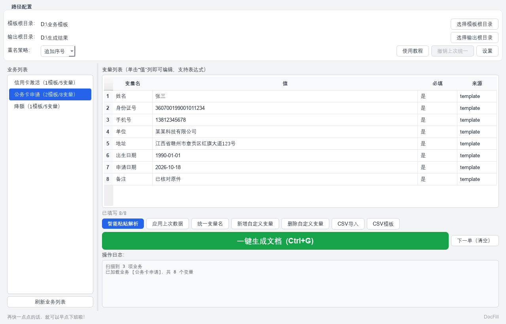
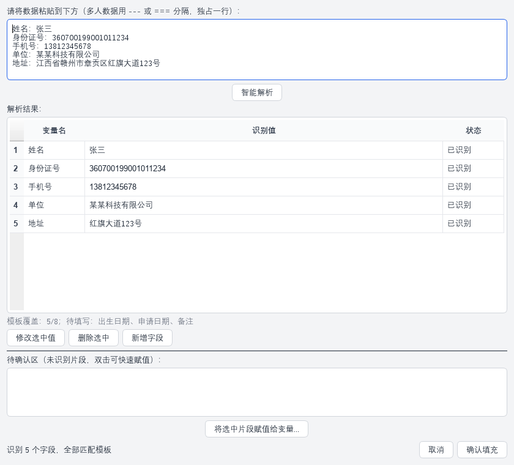
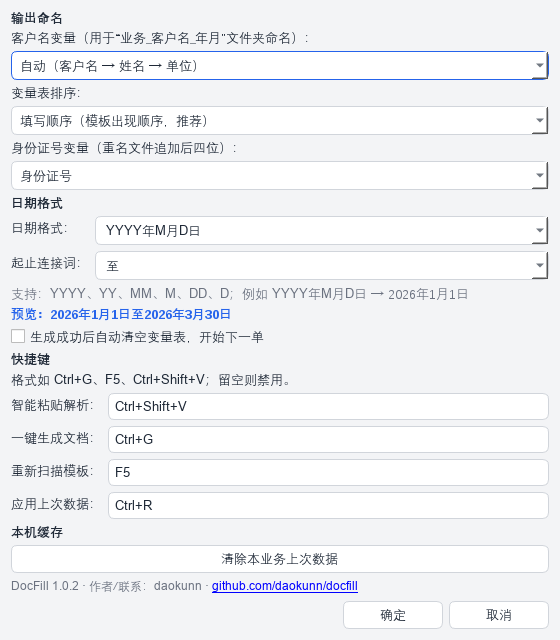
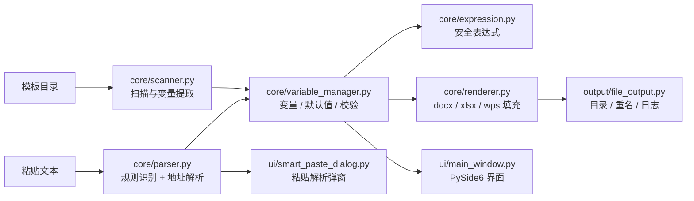

<div align="center">



<h1> DocFill</h1>

<p><b>文档智能解析与批量填充工具</b> · v1.0.2<br />
把一段客户资料，变成一整套填好的 Word / Excel 文档。</p>

<p>
  <a href="https://github.com/daokunn/docfill/actions/workflows/ci.yml">
    
  </a>
  
  
  
  
</p>

<p>
  <a href="#快速开始">快速开始</a> ·
  <a href="#界面预览">界面预览</a> ·
  <a href="#模板规范">模板规范</a> ·
  <a href="#项目架构">项目架构</a> ·
  <a href="docs/使用说明.md">详细使用说明</a>
</p>

</div>

---

## 这是什么

**DocFill** 是一个面向内网、离线环境的 Windows 桌面工具。它扫描 Word / Excel 模板中的 `{{变量}}`，把粘贴进来的原始业务文本解析成结构化字段，再批量生成整套文档。

- **完全离线**：不调用任何在线 API，不上传任何数据。
- **模板只读**：填充过程只读取模板，所有结果写入独立输出目录。
- **批量生成**：一次录入，生成同一业务下的全部 Word / Excel 模板。
- **面向真实业务**：支持多人数据、变量表达式、地址拆分、重名策略和操作日志。

> 适合银行、政务、保险、行政等需要“固定模板 + 大量重复填表”的场景。

## 三分钟上手

**一个人、一份资料：**

1. 选好 **模板根目录** 和 **输出根目录**（两者不要互相嵌套）。
2. 左侧点业务 → **智能粘贴解析** → 粘贴客户资料 → **智能解析** → **确认填充**。
3. 看一眼黄色空格（没填的）→ **一键生成文档** → 自动打开输出目录。

**一批人、资料分批到：**

1. 点 **人员名单** → **导入名单（Excel/CSV）**。第一行是变量名，之后每行一个人；没定的格子留空。
2. 用 **状态：待补充** 筛选，点 **下一位待补充** 逐人补录；同单位只改姓名/证件号时，右键 **复制为新行**；整列相同值可在列头右键 **整列填入同一值**。
3. 勾选要生成的人 → **生成选中文档**。已生成的会标绿，之后可用 **只生成未生成的** 断点续跑。

**几个省时间的开关（都在【设置】里，窗口可滚动）：**

- **自动编号**：勾选档案号/序号并填起始号，只有真正生成文档时才 +1，不会断号；生成错了可回收最后一个号。
- **打开与打印**：生成后自动打开全部/第一个/指定模板的文件，可选打印机、份数、静默打印。
- **移交清单**：每批生成按主键去重追加进同一张 Excel 台账，也可用自己的汇总模板表头。

> 设置页变长后已支持上下滚动，小屏幕也能完整操作。

## 下载

不装 Python 也可以直接用：到 [Releases](https://github.com/daokunn/docfill/releases/latest) 下载 **DocFill-v1.0.2.exe**，双击运行。

- `DocFill-v1.0.2.exe`：当前推荐版本，窗口标题 `DocFill 1.0.2`，带新图标、启动图和版本信息
- `DocFill-v1.0.1.exe` / `DocFill-v1.0.0.exe`：历史版本，保留用于回退

> 首次启动会解压几秒，请稍等；如果杀毒软件误报，添加信任即可。

## 为什么是 DocFill

| 传统做法 | DocFill |
| --- | --- |
| 在多个 Word / Excel 之间反复复制粘贴 | 一次录入，全部模板自动填充 |
| 手工拆分姓名、证件号、手机号、地址 | 粘贴原始文本，本地规则自动识别 |
| 文件命名混乱、重复生成互相覆盖 | 业务名_客户名_年月 + 三种重名策略 |
| 数据被上传到不明在线工具 | 全程本地运行，数据不出电脑 |
| 模板被误改，原文件丢失 | 生成到独立目录，模板保持只读 |

## 功能

- **模板扫描**：递归扫描业务目录，自动提取 `.docx` / `.xlsx` / `.wps` / `.et` 中的变量，多个模板的同名变量自动合并；支持 `{{备注?}}` 标记可选变量。
- **智能粘贴**：基于本地正则规则 + 键值对识别，支持姓名、身份证号、手机号、单位、地址、日期等字段；解析结果会显示模板覆盖情况和未使用字段。
- **地址拆分**：内置省市区字典，将完整地址拆成省 / 市 / 区 / 详细地址；`家庭住址 / 住址` 等写法自动归到“地址”。
- **多人模式**：用独占一行的 `---` 或 `===`，也可以直接用空行分隔多人数据，逐人生成文档；每个人使用独立变量，不会串上一位客户的数据。
- **变量表达式**：`substr`、`concat`、`split`、`replace`、`today` 等函数，身份证取出生日期、地址取城市等场景无需手算。
- **日期格式**：输入 `20260101`，按设置的格式输出 `2026年1月1日` / `2026-01-01` / `20260101`；起止时间自动识别并格式化。
- **变量表排序**：默认按模板填写顺序排列，也可以在设置里切换为字典顺序。
- **输出治理**：按 `业务名_客户名_年月` 建目录；客户名按“客户名 → 姓名 → 单位”自动兜底；支持追加序号 / 覆盖 / 跳过，自动写操作日志。
- **连续办单**：生成后可直接“下一单”清空变量，或设置自动清空；“应用上次数据”会保存到本机，重启后仍可复用。
- **自动编号**：档案号/管理序号可在【设置】里多选变量并填起始号；只有真正生成文档时才 +1，没出的文档不占号，不会断号。格式随意，程序只把最后一段数字加 1（如 `XJH202242312300001 → …002`）。窗口左下角会显示下一个号码；生成错了可回收最后一个号或手动指定当前号。
- **生成后打开/打印**：可选自动打开本次全部文件、第一个文件，或勾选一个/多个模板只打开它们生成的新文件；打开后可自动送指定打印机（可设份数、静默打印，程序不弹打印框），文件保持打开不自动关闭。
- **批量补录**：名单支持按状态筛选（待补充/已填完/已生成）、“下一位待补充”跳转、整列批量填同一值、复制上一行为新行，适合同单位只改姓名/证件号的场景。
- **移交清单台账**：每批人员生成后可按主键去重追加进同一张 Excel 移交清单，首次可用自己的汇总模板表头。
- **数据导入**：CSV 自动识别 UTF-8 / GBK，导入前预览，支持表头；可导出 CSV 模板；变量表支持从 Excel 整列/多列粘贴。
- **修改可回退**：“统一变量名”修改前自动备份模板，支持一键撤销；生成前检查空变量和“未知客户”，不再静默产出半成品。
- **本地配置**：识别规则、默认值、别名、地址字典均可外置修改，无需改代码。
- **桌面体验**：DocFill 图标、启动图、Windows 版本信息；窗口大小自动记忆，底部写着“再快一点点的话，就可以早点下班啦！”。
- **边界处理**：输出目录不能放进模板目录；页眉页脚表格已支持，文本框做基础替换；模板多时显示生成进度并可取消。

## 本次体验改进（P0）

这一版优先修复日常使用中最容易出错的 8 个点：

| 之前 | 现在 |
| --- | --- |
| 输入 `20260101-20260330` 后，还要再手输一遍开始时间 | `开始时间 / 开始日期 / 起始时间` 自动归组，时间段一次填满 |
| 日期只能按 `2026-01-01` 输出 | 设置里可选 `YYYY年M月D日`，起止连接词可配置 |
| 模板只有 `{{姓名}}`，目录却是“未知客户” | 客户名按“客户名 → 姓名 → 单位”兜底，生成前显示目录 |
| 空行分隔多人无效 | 空行、`---`、`===` 都支持，先逐人核对再生成 |
| 批量生成会串上一位客户的数据 | 每人独立变量表，不继承上一位的值 |
| 8 位项目编号被改成假日期 | 只对日期字段归一化，`20260001` 原样保留 |
| 空变量仍然提示“生成成功” | 生成前列出空变量和“未知客户”，默认返回修改 |
| “统一变量名”改坏模板无法恢复 | 修改前自动备份、预览处数，支持一键撤销 |

## 本次体验改进（P1）

| 之前 | 现在 |
| --- | --- |
| 变量表默认按字典序，和填表顺序不一致 | 默认按模板出现顺序；设置里可切换“填写顺序 / 字典顺序” |
| 所有变量都必填，备注也要反复确认 | 模板写 `{{备注?}}` 即可标记可选，生成前不再提示 |
| 智能粘贴只显示识别到的字段 | 增加“模板覆盖 5/8；待填写：…”提示，未使用字段单独标记 |
| 生成后值还留在表里，容易带到下一单 | 新增“下一单（清空）”，可设置生成后自动清空 |
| “应用上次数据”重启就丢 | 按业务保存到本机，重启后仍可复用；设置里可清除 |
| Excel 导出的 CSV 常因 GBK 编码导入失败 | 自动识别 UTF-8 / GBK，导入前预览，可勾选表头，支持导出 CSV 模板 |
| 变量表只能一格一格填 | 支持从 Excel 整列或多列粘贴 |
| 身份证变量、排序、缓存都藏在 JSON 里 | 设置界面可选身份证变量、变量顺序，并可清除本机缓存 |

## 本次体验改进（P2）

| 之前 | 现在 |
| --- | --- |
| 小屏 / 高缩放下底部按钮可能被截断 | 首次启动按屏幕自适应，记住窗口大小，最小尺寸 980×640 |
| 生成多个文档时界面像卡住 | 模板较多时显示进度和当前文件名，可取消 |
| 输出目录可以选进模板目录 | 选目录和生成时都会拦截，避免模板和结果混在一起 |
| 页眉页脚表格、文本框里的变量扫不到 | 页眉页脚表格已支持；文本框做基础替换，并保留复杂文本框限制说明 |
| Word 填充会合并 run、改字号，撑高行距导致表格跳页 | **版式保护渲染**：只改文字节点，不动任何字体/段落/表格/页面属性 |
| 数据比占位符长时格子必然多占行，最后一行被挤到下一页 | 可选例外：**自动缩小溢出单元格的字号**保住页数（最多缩到原字号 70%，可在设置关闭） |
| exe 没有图标、版本信息和启动画面 | 新增 DocFill 图标、Windows 版本信息、启动图，启动过程不再“黑屏等” |
| 使用教程像说明书，小白看不懂 | 重写为“看这三步就够了”，用选文件夹、粘贴、点按钮的语言说明 |
| 窗口底部空着 | 左下角加了一句：**再快一点点的话，就可以早点下班啦！** |

## 界面预览

主界面已在上方展示。下面是智能粘贴解析的工作方式：粘贴原始文本，本地规则自动拆出姓名、证件号、手机号和地址。



### 新手教程

第一次用可以直接点主界面的 **【使用教程】**，会看到从“选两个文件夹”到“下一单”的三步说明：


## 快速开始

### 环境要求

- Windows 10 / 11（64 位）
- Python 3.11（推荐；3.9+ 理论可用，未逐一验证）
- 依赖：PySide6、python-docx、openpyxl

### 从源码运行

```powershell
git clone https://github.com/daokunn/docfill.git
cd docfill

python -m venv .venv
.\.venv\Scripts\Activate.ps1
python -m pip install -r requirements.txt

python main.py
```

如果 PowerShell 阻止激活虚拟环境，可只在当前窗口临时放开：

```powershell
Set-ExecutionPolicy -Scope Process -ExecutionPolicy Bypass
```

### 5 分钟跑通示例

仓库自带一套演示模板和虚构数据：

1. 启动后，**模板根目录**选择 `examples\templates`。
2. **输出根目录**选择 `examples\output`。
3. 左侧选择 **公务卡申请**。
4. 点击 **智能粘贴解析**，粘贴下面的示例文本，点击 **智能解析** → **确认填充**。
5. 点击 **一键生成文档**，在 `examples\output` 查看结果。
6. 如需调整日期写法，点右上角 **设置**，选择 `YYYY年M月D日` 等格式；设置会实时预览。

```text
姓名：张三
身份证号：360700199001011234
手机号：13812345678
单位：某某科技有限公司
地址：江西省赣州市章贡区红旗大道123号
申请日期：2026-10-18
```

> 示例中的姓名、证件号码、手机号均为虚构数据，仅用于演示。

### 打包为 exe

```powershell
python -m pip install -r requirements-dev.txt
python -m PyInstaller build.spec --noconfirm
```

产物位于 `dist\DocFill.exe`，带 DocFill 图标、Windows 版本信息和启动图。需要带控制台的调试版时：

```powershell
$env:APP_CONSOLE = "1"
python -m PyInstaller build.spec --noconfirm --distpath build\probe_dist
```

## 使用流程

```text
设置模板目录 / 输出目录
        ↓
选择业务（一级子文件夹 = 一项业务）
        ↓
填写变量 或 智能粘贴解析
        ↓
生成前检查 → 一键生成 → 打开输出目录
```

一次完整操作通常只需要：**选业务 → 粘贴 → 核对 → 生成**。

## 模板规范

### 目录结构

模板根目录下，每个一级子文件夹代表一项业务：

```text
模板根目录/
├── 公务卡申请/
│   ├── 申请表.docx
│   └── 信息登记表.xlsx
├── 信用卡激活/
│   └── 激活申请表.docx
└── 降额/
    └── 降额申请书.docx
```

业务文件夹内可以继续建子目录，生成结果会还原同样的目录层级。

### 变量写法

在 Word 或 Excel 中，把需要填写的位置写成：

```text
{{姓名}}
{{身份证号}}
{{申请日期}}
```

也可以兼容 `${姓名}` 写法。变量名建议使用中文、字母、数字、下划线，避免空格和特殊符号。

**可选变量**：在变量名后加 `?`，例如 `{{备注?}}`，该变量不会在生成前被当作必填项；其他变量默认必填。

### 支持的格式

| 格式 | 说明 |
| --- | --- |
| `.docx` | 推荐，支持正文、表格、页眉页脚 |
| `.xlsx` | 推荐，支持所有工作表单元格 |
| `.wps` / `.et` | 仅支持新版 OOXML 格式；旧版二进制格式请先另存为 `.docx` / `.xlsx` |

## 智能粘贴

智能粘贴完全在本地运行，由三层能力组成：

1. **正则规则**：身份证号、手机号、日期、项目编号等强格式字段。
2. **键值对识别**：`姓名：张三`、`手机号=138...` 等常见写法。
3. **地址二次解析**：命中“地址”后，用本地省市区字典拆出省、市、区，剩余部分作为详细地址。

识别结果会先映射到当前模板的变量：模板中没有的字段会标记为“未使用”，不会静默新增自定义变量；只有匹配到的字段和手动新增字段会写入变量表。

规则位于 [`config/rules.json`](config/rules.json)，可以按业务自行增删。每条规则包含：

```json
{
  "field": "手机号",
  "pattern": "^1[3-9]\\d{9}$",
  "priority": 2,
  "label": "手机号"
}
```

### 多人模式

多人数据可以用独占一行的 `---` / `===` 分隔，也可以直接用空行分隔：

```text
姓名：张三
身份证号：360700199001011234

姓名：李四
身份证号：360700199203035678
```

解析后可在下拉框中逐人核对，确认后批量生成。每个人使用独立的变量表，不会把上一位客户的值带进下一位。

### 日期格式

日期在内部统一保存为 `YYYY-MM-DD`，写入文档前再按设置转换：

- 默认 `YYYY年M月D日`：`20260101` → `2026年1月1日`
- 可选 `YYYY-MM-DD`、`YYYY/MM/DD`、`YYYYMMDD`、`M月D日`
- 起止时间连接词可选“至 / 到 / ~ / —”
- 字段名包含“日期 / 时间 / 出生 / 起始 / 截止 / 起止”等关键词时才按日期处理，项目编号等 8 位数字不会被误改

设置入口：主窗口右上角 **设置 → 日期格式**，修改后可实时预览。



## 变量表达式

变量值可以是普通文本，也可以是表达式。表达式由 AST 白名单校验后执行，不开放任意 Python 代码。

| 函数 | 说明 | 示例 |
| --- | --- | --- |
| `substr(s, start, length)` | 截取子串 | `substr(身份证号, 6, 8)` → `19900101` |
| `concat(a, b, ...)` | 拼接 | `concat(姓, 名)` |
| `split(s, sep, index)` | 拆分取段 | `split(地址, "省", 0)` |
| `replace(s, old, new)` | 替换 | `replace(手机号, "-", "")` |
| `upper(s)` / `lower(s)` | 大小写转换 | `upper(编号)` |
| `trim(s)` / `len(s)` | 去空白 / 长度 | `trim(姓名)` |
| `today()` | 当前日期 | `2026-10-18` |
| `year()` / `month()` / `day()` | 当前年 / 月 / 日 | `2026` |
| `int(v)` / `str(v)` | 类型转换 | `int(数量)` |
| `regex_extract(s, pattern, group)` | 正则提取 | `regex_extract(备注, "\\d+", 0)` |

变量之间可以互相引用。例如把 `出生日期` 设为：

```text
concat(substr(身份证号, 6, 4), "-", substr(身份证号, 10, 2), "-", substr(身份证号, 12, 2))
```

填写身份证号后，出生日期会自动计算。

## 项目架构



模块之间通过数据交互，保持低耦合：

- `core/scanner.py`：只负责扫描目录、提取变量，不填充。
- `core/parser.py`：只负责文本 → 字段，可独立测试。
- `core/variable_manager.py`：只负责变量存储、默认值、校验和表达式解析。
- `core/renderer.py`：只负责模板 → 输出文档副本，不关心 UI。
- `output/file_output.py`：只负责输出目录、重名策略和日志。
- `ui/`：只负责交互，不实现业务算法。

## 项目结构

```text
docfill/
├── main.py                     # GUI / CLI 入口
├── app_paths.py                # 源码 / PyInstaller 路径适配
├── build.spec                  # PyInstaller 打包配置（图标 / 启动图 / 版本信息）
├── version_info.txt            # Windows 文件版本元数据
├── assets/
│   ├── docfill.ico             # 应用图标
│   ├── docfill.png             # README / 品牌图
│   └── splash.png              # onefile 启动图
├── config/
│   ├── settings.py             # 配置读写
│   ├── settings.example.json   # 配置模板（本地 settings.json 不入库）
│   ├── rules.json              # 智能识别规则
│   ├── defaults.json           # 业务变量默认值
│   └── aliases.json            # 变量别名映射
├── core/
│   ├── scanner.py              # 目录扫描 / 变量提取
│   ├── parser.py               # 智能粘贴解析
│   ├── field_mapper.py         # 识别字段 → 模板变量映射
│   ├── date_format.py          # 日期解析与输出格式化
│   ├── address_parser.py       # 地址拆分
│   ├── expression.py           # 安全表达式引擎
│   ├── variable_manager.py     # 变量管理
│   ├── preflight.py            # 生成前空变量检查
│   ├── template_backup.py      # 模板备份 / 撤销
│   ├── csv_io.py               # CSV 编码 / 表头 / 预览解析
│   ├── user_state.py           # 上次数据本机缓存
│   └── renderer.py             # 文档渲染
├── output/
│   └── file_output.py          # 输出目录 / 重名 / 日志
├── ui/
│   ├── main_window.py          # 主窗口
│   ├── smart_paste_dialog.py   # 智能粘贴弹窗
│   ├── csv_import_dialog.py    # CSV 导入预览
│   ├── widgets.py              # 支持整列粘贴的变量表
│   └── style.py                # QSS 主题与内置教程
├── data/
│   └── region_dict.json        # 省市区字典
├── examples/
│   ├── templates/              # 演示模板
│   └── output/                 # 演示输出（不入库）
├── tests/
│   ├── comprehensive_test.py   # 108 项全量测试
│   ├── test_smoke.py           # pytest 快速烟雾测试
│   ├── test_p0.py              # P0 回归测试
│   ├── test_p1.py              # P1 回归测试
│   ├── test_p2.py              # P2 回归测试
│   └── comprehensive_templates/# 测试模板
├── docs/
│   ├── 使用说明.md
│   └── screenshots/
├── requirements.txt
├── requirements-dev.txt
├── pyproject.toml
└── LICENSE
```

## 测试与质量

项目包含一套 108 项的全量测试，覆盖解析、扫描、渲染、变量、输出和边界场景：

```powershell
python tests\comprehensive_test.py
```

当前结果：

```text
测试结果汇总：通过 108，失败 0，发现 Bug 0
```

快速烟雾测试 + P0 回归（需安装开发依赖）：

```powershell
python -m pip install -r requirements-dev.txt
python -m pytest tests\test_smoke.py tests\test_p0.py tests\test_p1.py tests\test_p2.py -q
```

当前结果：`25 passed`，覆盖日期格式、起止时间别名、项目编号防误判、多人空行分隔、客户名兜底、模板备份/撤销、可选变量、变量排序、本机缓存、CSV 编码、目录防护和页眉表格。

CI 在 Windows + Python 3.11 上执行字节编译、pytest 回归和全量测试，见 [`.github/workflows/ci.yml`](.github/workflows/ci.yml)。

## 配置说明

| 文件 | 是否入库 | 作用 |
| --- | --- | --- |
| `config/settings.json` | 否 | 本机模板 / 输出路径、日期格式、客户名/身份证变量、排序、快捷键、重名策略、溢出缩字号开关 |
| `config/settings.example.json` | 是 | 配置模板，首次运行可参考 |
| `config/rules.json` | 是 | 智能识别的正则规则 |
| `config/defaults.json` | 是 | 按业务配置变量默认值 / 表达式 |
| `config/aliases.json` | 是 | 变量别名映射，可在界面中自动累积 |
| `data/region_dict.json` | 是 | 地址解析字典，目前内置江西省 |
| `.docfill_backups/` | 否 | “统一变量名”修改前的模板备份，支持一键撤销 |
| `.docfill_state/` | 否 | 本机“上次数据”缓存，可在设置里清除 |

`config/settings.json` 含本机路径，已在 `.gitignore` 中排除。首次运行会自动生成默认配置；也可以复制 `settings.example.json` 后修改。

## 版式保护（不跳页的关键）

Word 模板最常见的坑：本来刚好一页的表格，填完数据最后一行被挤到第二页。原因通常是**填充程序动了格式**——把整段文字合并成一个 run、沿用第一个片段的字号，导致行距变化。

DocFill 的默认策略是**版式保护渲染**：

- 直接修改 docx 内部的 `w:t` 文字节点，**只替换文字**；
- 不合并 run、不清空 run、不改段落/表格/单元格/页面任何属性；
- 字体、字号、加粗、列宽、行高、页边距、分页设置全部原样保留。

因此只要你的数据长度没超过格子能放的量，**页数不会变**。

唯一的例外由你授权：**内容超出格子时自动缩小字号**。当真实数据明显长于占位符、格子里必然多占行时，程序会把该单元格的字号适度调小以保住页数：

- 只在“填充后行数 > 填充前行数”时才触发，能放下就绝不缩；
- 用实际字体度量估算行数，二分查找最小缩放，尽量贴近原字号；
- 最多缩到原字号的 70%，再长也不缩成蚂蚁字（此时宁可溢出并记录日志）；
- 每次调整都会写进操作日志和输出目录的 `operation.log`，例如 `第3行：14→11 磅（防溢出）`；
- 在【设置】里可关闭此开关，关闭后退回纯版式保护，一个字都不动。

> 注意：Excel（`.xlsx`）仍使用 openpyxl 保存，单元格换行不受此机制影响；本机制针对 Word 表格。

## 隐私与安全

- **无网络请求**：程序不包含 HTTP 客户端，不调用任何在线 API，也不收集遥测数据。
- **数据留在本机**：模板解析、地址拆分、文档生成全部在本地完成。
- **模板只读**：填充只读取模板，结果写入独立输出目录；只有“统一变量名”功能会在二次确认后修改所选模板。
- **本机缓存**：“应用上次数据”会把最近一次数据保存在 `.docfill_state/`（纯本地 JSON），可在设置里一键清除；不会上传。
- **谨慎分享产物**：生成的文档和 `operation.log` 可能包含姓名、证件号等个人信息。`.gitignore` 已排除 `output/`、`examples/output/`、测试输出目录和本机缓存，提交前仍建议检查 `git status`。

## 已知限制

- 目前以 Windows 为主要开发和验证平台，信创 / 麒麟环境尚未验证。
- `.wps` / `.et` 仅支持新版 OOXML；旧版二进制格式请先另存为 `.docx` / `.xlsx`。
- 地址字典目前只覆盖江西省，其他省份可自行扩展 `data/region_dict.json`。
- 不包含 OCR / PDF 解析，只处理 Word / Excel 模板。
- 页眉页脚表格已支持；文本框做基础替换，跨多个 run 的复杂文本框仍可能无法完整识别。
- Word 版式保护只保证“不主动改格式”；若数据长度远超格子容量，即使自动缩小字号也可能无法完全避免溢出，此时会记录日志并保持可读下限。
- “统一变量名”会修改模板文件；修改前会自动备份，可一键撤销，但仍建议操作前确认。

## 参与贡献

欢迎提交 Issue 和 Pull Request：

1. Fork 本仓库并创建分支：`git checkout -b feat/your-feature`。
2. 保持改动聚焦，补充或更新测试。
3. 提交前运行 `python tests\comprehensive_test.py`。
4. 在 PR 中说明动机、改动和验证方式。

如果这个项目对你有帮助，欢迎点一个 **Star**。

## 作者与联系

- **作者 / 联系：** daokunn
- **GitHub：** [@daokunn](https://github.com/daokunn)
- **项目主页：** [github.com/daokunn/docfill](https://github.com/daokunn/docfill)
- **问题反馈：** [GitHub Issues](https://github.com/daokunn/docfill/issues)
- 软件内也可在 **设置 → 本机缓存下方** 看到版本、作者和 GitHub 地址。

## License

[MIT](LICENSE) © 2026 daokunn

---

<p align="center">
  <sub>DocFill · 本地运行，数据不出电脑。</sub>
</p>
